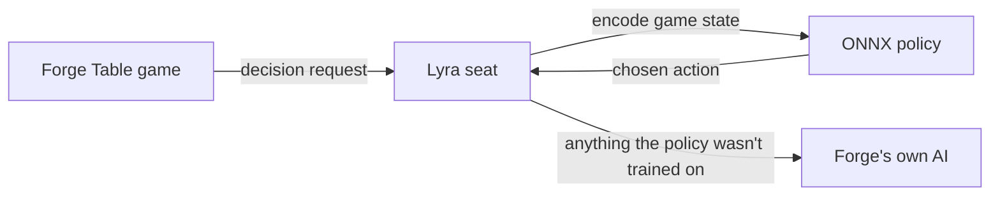

<h1 align="center">lyra-forge-plugin</h1>

<p align="center">
  <b>A neural network opponent for Magic: The Gathering, playing inside the Forge rules engine.</b><br>
  Pick Lyra in a Forge Table lobby like any other AI and see how a self-trained policy plays your deck.
</p>

<p align="center">
  <a href="#quick-start">Quick start</a> ·
  <a href="#features">Features</a> ·
  <a href="docs/build.md">Build guide</a> ·
  <a href="docs/configuration.md">Configuration</a> ·
  <a href="#docs">Docs</a>
</p>

<p align="center">
  <a href="LICENSE"></a>
  
</p>



This is a [Forge](https://github.com/Card-Forge/forge) AI seat driven by an ONNX policy called Lyra, trained by
self-play inside the Forge rules engine. The policy makes the game decisions it was trained on, and everything else
(mana payment details, trigger ordering and so on) falls back to Forge's own AI. The same code also holds the headless
runner Lyra was trained with: seeded games without a GUI, self-play workers that write training trajectories, and a
few benchmarking and replay tools.

**This is alpha software.** Expect bugs and rough edges. Settings, saved data and the plugin interface may change
between releases. Bug reports and feature requests are welcome.

## Quick start

You need JDK 21, Maven 3.9 or newer and Git. The plugin builds against [Forge Table](https://github.com/mdbook/forge-table),
the Forge fork that has the hooks it needs; stock Forge won't load it.

1. Install the engine into your local Maven repository, then build the plugin. Forge Table has no release tag yet, so
   this pins a known-good commit:

   ```bash
   git clone https://github.com/mdbook/forge-table
   cd forge-table && git checkout 1a127f06d02f3e8085ee4100b0b81160c8250e2e
   mvn -B -pl forge-ai -am -DskipTests -Dcheckstyle.skip -Dmaven.javadoc.skip=true install
   cd ..
   git clone https://github.com/mdbook/lyra-forge-plugin
   cd lyra-forge-plugin
   mvn -B package
   ```

   The GitLab `readme-quick-start` job runs the Forge Table clone, pinned checkout, install and plugin build commands
   above with JDK 21 and Maven 3.9. It uses GitLab's plugin checkout instead of cloning the default branch, so it tests
   the revision under review. CI caches the local Maven repository (`~/.m2/repository`, relocated into the checkout).

2. Download the Lyra model from the
   [v0.1.0-alpha.1 release](https://github.com/mdbook/lyra-forge-plugin/releases/tag/v0.1.0-alpha.1) and check it:

   ```bash
   curl -LO https://github.com/mdbook/lyra-forge-plugin/releases/download/v0.1.0-alpha.1/lyra-model-v111994.zip
   sha256sum lyra-model-v111994.zip   # 27f35422949fa040fb9bfeec2ec1709bed6f7e24f3001555ad3196e13be3e179
   unzip lyra-model-v111994.zip       # makes neural/
   ```

3. Play four headless games, Lyra against Forge's default AI (about a minute on a laptop):

   ```bash
   java -Xmx3g -Xss8m -jar target/lyra-forge-plugin-0.1.0-alpha.1-all.jar --res ../forge-table/forge-gui/res \
     bench -a onnx,forge-default --model neural --vocab neural/registry.tsv \
     -d neural/2026-09-28/elves.dck,neural/2026-09-28/tron.dck -n 4 --seed 1
   ```

   It prints a summary table with each seat's wins. If it does, the build, the model and the engine fit together.

To play Lyra yourself in Forge Table, pack the plugin and model into an overlay zip and unpack it over a Forge Table
release folder:

```bash
scripts/overlay.sh --model lyra-model-v111994.zip   # writes target/lyra-forge-plugin-0.1.0-alpha.1-overlay.zip
```

Start Forge Table, set an opponent slot's AI profile to `Neural`, pick a deck for each seat (the overlay's `decks/`
folder has the ones Lyra plays best) and start the game. The [build guide](docs/build.md) has the details.

## Configuration

The seat reads its model from the folder named by `-Dmtgai.neural.dir` (default `neural`, relative to Forge's
working directory). The model release ships that folder ready to use. The settings you are most likely to want:

| property | what |
|---|---|
| `-Dmtgai.neural.dir=DIR` | the model folder (default `neural`) |
| `-Dmtgai.neural.log=true` | print the seat's decisions and a game-over line to the console |
| `-Dmtgai.neural.greedy=false` | sample the policy instead of always taking its top choice |

Run the game with a larger thread stack (`-Xss8m`), as Forge Table's launchers do. Every property and the model
folder layout are in the [configuration reference](docs/configuration.md).

## Features

- **A real Forge seat.** Forge Table creates it by class name for any lobby slot with the `Neural` AI profile, so it
  plays with the same rules engine and card scripts as every other opponent.
- **Policy where it was trained, Forge's AI everywhere else.** Lyra decides priority, targets, combat, mulligans,
  costs and many effect choices itself; anything outside that goes to Forge's Default AI profile. The full list is in
  [architecture](docs/architecture.md#decision-surface).
- **Checked models.** The seat refuses a model whose sha256 or encoder version doesn't match this build, with a clear
  error, and update pointers are verified with an Ed25519 signature.
- **Headless runner.** Seeded games without a GUI for benchmarking, single-game logs, deck validation, self-play
  trajectory writing and replaying a recorded game. See the [CLI guide](docs/cli.md).
- **Search variants.** Determinised search seats (`pimc-<budget>`, `gumbel-<n>`) on top of the policy, for
  experiments.

## Docs

- [Build guide](docs/build.md): building against Forge Table, the jars, the overlay zip and the model release.
- [Configuration](docs/configuration.md): the model folder and every system property the seat reads.
- [CLI guide](docs/cli.md): the headless runner's commands, options and seat names.
- [Architecture](docs/architecture.md): the package layout and exactly what the policy decides.

## Contributing

See [CONTRIBUTING.md](CONTRIBUTING.md) for the build, the checks and the conventions.

## License

Copyright (C) 2026 Mik Burke

This program is free software: you can redistribute it and/or modify it under the terms of the GNU General
Public License as published by the Free Software Foundation, either version 3 of the License, or (at your
option) any later version. It links directly against Forge's forge-core, forge-game and forge-ai packages. This
program is distributed WITHOUT ANY WARRANTY; without even the implied warranty of MERCHANTABILITY or FITNESS
FOR A PARTICULAR PURPOSE. See `LICENSE` for the full text.

The trained model weights (Lyra) are released separately under AGPL-3.0, with their own notice.

Lyra and lyra-forge-plugin are unofficial Fan Content permitted under the Fan Content Policy. Not
approved/endorsed by Wizards. Portions of the materials used are property of Wizards of the Coast. ©Wizards of
the Coast LLC.
